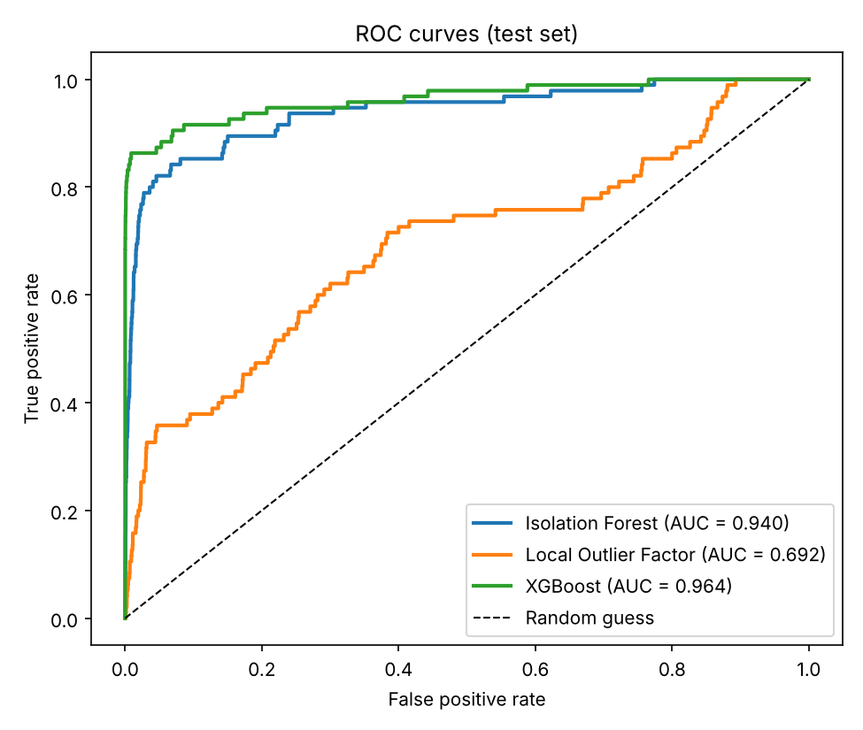
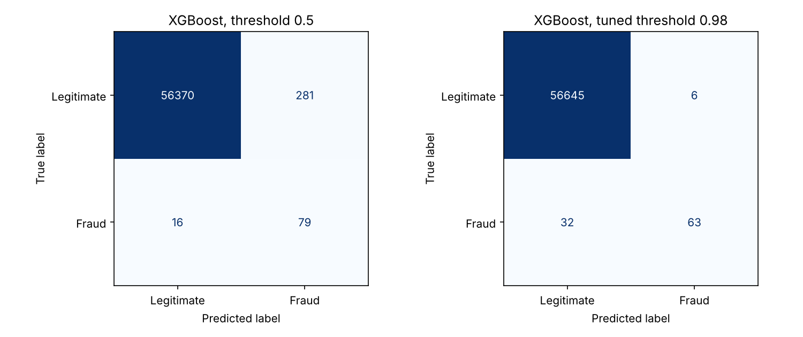

# Fraud Detection in Credit Card Transactions

Identify fraudulent credit card transactions using anomaly detection (Isolation Forest, Local Outlier Factor) and a supervised XGBoost classifier, with a Streamlit app for predictions.

## Deliverables

| # | Deliverable | Link |
|---|---|---|
| 1 | GitHub repository | https://github.com/edeki101/credit-card-fraud-detection |
| 2 | Jupyter notebook | [fraud_detection.ipynb](fraud_detection.ipynb) |
| 3 | Streamlit app | https://edeki101-credit-card-fraud-detection.streamlit.app/ |
| 4 | Confusion matrix and other charts | [outputs/](outputs/) |
| 5 | Project report (2 pages, PDF) | [report/Fraud_Detection_Report.pdf](report/Fraud_Detection_Report.pdf) |

## Results





Test set: 56,746 transactions, of which 95 are fraud.

| Model | ROC-AUC | PR-AUC | Precision | Recall | F1 |
|---|---|---|---|---|---|
| Isolation Forest | 0.940 | 0.127 | 0.224 | 0.253 | 0.238 |
| Local Outlier Factor | 0.692 | 0.009 | 0.021 | 0.021 | 0.021 |
| XGBoost (threshold 0.5) | 0.964 | 0.766 | 0.219 | 0.832 | 0.347 |
| **XGBoost (tuned threshold 0.98)** | **0.964** | **0.766** | **0.913** | **0.663** | **0.768** |

With the tuned threshold, XGBoost catches 63 of the 95 frauds and raises only 6 false alarms among 56,651 legitimate transactions. The threshold was chosen on a separate validation set, not on the test set.

Accuracy is not used, because a model that never flags fraud would score about 99.8%. PR-AUC is average precision.

## Project structure

```
credit-card-fraud-detection/
├── fraud_detection.ipynb     # full pipeline
├── app.py                    # Streamlit app
├── requirements.txt
├── data/sample_transactions.csv   # 200 demo transactions from the test set
├── models/                   # xgb_fraud.json, amount_scaler.joblib
├── outputs/                  # charts and results.json
└── report/                   # PDF report
```

## Dataset

[Credit Card Fraud Detection](https://www.kaggle.com/datasets/mlg-ulb/creditcardfraud) (ULB Machine Learning Group): 284,807 transactions by European cardholders over two days in 2013, 492 of them fraud. Features V1-V28 are anonymized PCA components, plus Amount and Time. The file is about 100 MB, so it is not stored in this repository. The notebook downloads it automatically, or you can place the Kaggle `creditcard.csv` in a `data/` folder.

## How to run

**Google Colab (nothing to install)**

1. Open https://colab.research.google.com and choose **File > Upload notebook**.
2. Select `fraud_detection.ipynb`, then click **Runtime > Run all**. It takes a few minutes.

**Your own computer**

```bash
git clone https://github.com/edeki101/credit-card-fraud-detection.git
cd credit-card-fraud-detection
pip install -r requirements.txt
streamlit run app.py
```

## How the project is built

1. **Load and clean.** Remove 1,081 duplicate rows, apply log and standardization to Amount, drop Time.
2. **Split.** Stratified 80/20 train/test split, so the test set keeps the real 0.17% fraud rate.
3. **Anomaly detection.** Isolation Forest and Local Outlier Factor are fitted without labels. LOF uses a 30,000-row sample for speed.
4. **Balance.** A validation set is held out, then SMOTE balances the training data. SMOTE is never applied to validation or test data.
5. **XGBoost.** Trained on the balanced data, with early stopping on the validation set.
6. **Evaluate.** ROC curve, precision-recall curve, confusion matrix, feature importance.

## The Streamlit app

- **Check one transaction:** load a real example (legitimate or fraud) from the test set, edit the values, and see the fraud probability.
- **Score a CSV file:** upload a file with columns V1-V28 and Amount, or use the built-in demo file.
- **Model performance:** metrics and charts.

To deploy it free on Streamlit Community Cloud: sign in at https://share.streamlit.io with GitHub, click **Create app**, choose repository `edeki101/credit-card-fraud-detection`, branch `main`, and main file path `app.py`, then click **Deploy**.

## Limitations

- Only 95 frauds are in the test set, so the numbers are uncertain.
- The data is anonymized and covers two days in 2013. The split is random, not chronological, so real-world performance would be lower.
- Predicted probabilities are shifted by SMOTE, which is why the best threshold is high (0.98).

This is an educational project, not a production fraud system.

## Author

**Ekundayo Monday Edeki**: [GitHub](https://github.com/edeki101) | [LinkedIn](https://linkedin.com/in/edeki-monday-ekundayo)
